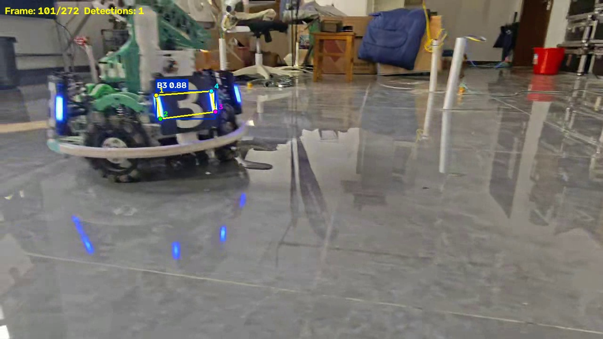

# YOLO26n 装甲板四点检测视频推理

基于 YOLO26n 模型的装甲板目标检测与四点关键点推理项目。

## 1. 项目功能

本项目使用课程提供的 YOLO26n 装甲板模型（`best.pt`），对自行拍摄的装甲板视频执行推理，实现以下功能：

- 加载模型权重，读取输入视频
- 逐帧执行目标检测推理
- 在画面上实时绘制：
  - **检测框**（Bounding Box）
  - **类别名称**（B1 / B2 / B3 / R1 / R2 / R3）
  - **置信度**（Confidence Score）
  - **4 个二维关键点**（模型预测的装甲板四角，编号 1~4，用线连接闭合）
- 保存与原视频对应、可正常播放的推理结果视频

> 关键点均来自模型预测结果（`result.keypoints`），非检测框四角。

## 2. 运行环境

| 项目 | 说明 |
|------|------|
| Python 版本 | Python 3.14 |
| 主要依赖 | ultralytics 8.4.x、PyTorch 2.14、OpenCV 4.x、NumPy 2.x |
| 推理设备 | CPU（作业允许 CPU / GPU，不要求实时推理） |

如需 GPU 加速，安装 CUDA 版 PyTorch 后，推理脚本会自动检测并使用。

## 3. 模型权重准备

1. 从作业"参考材料"中下载 `best.pt`
2. 将权重文件放置到项目根目录下的 `weights/` 文件夹中：

```
yolo-armor-inference/
├── weights/
│   └── best.pt        # 模型权重（不提交 Git）
├── infer.py
├── requirements.txt
├── README.md
├── .gitignore
├── input.mp4          # 原始视频（不提交 Git）
└── output/
    └── result.mp4     # 推理结果视频（不提交 Git）
```

## 4. 安装与运行

### 安装依赖

```bash
pip install -r requirements.txt
```

### 运行推理

```bash
python infer.py --model weights/best.pt --video input.mp4 --output output/result.mp4
```

### 可选参数

| 参数 | 默认值 | 说明 |
|------|--------|------|
| `--model` | `weights/best.pt` | 模型权重路径 |
| `--video` | `input.mp4` | 输入视频路径 |
| `--output` | `output/result.mp4` | 输出视频路径 |
| `--conf` | `0.25` | 置信度阈值 |
| `--device` | 自动 | 推理设备：`cpu` / `cuda` |
| `--imgsz` | `640` | 推理输入尺寸 |

### 结果保存位置

推理结果视频默认保存到 `output/result.mp4`。

## 5. 视频拍摄说明

| 项目 | 说明 |
|------|------|
| 拍摄地点 | 水建学院 D414 实验室 |
| 视频时长 | 约 9.1 秒 |
| 分辨率 | 1280 × 720 |
| 帧率 | 29.9 FPS |
| 场景说明 | 实验室场地内，机器人搭载 B3 装甲板行驶，镜头跟随拍摄 |

## 6. 检测结果示例

下图为推理结果视频中的一帧，可以看到检测框、类别标签（B3）、置信度（0.88）以及 4 个关键点（编号 1~4，黄色连线闭合）：



## 7. 实际识别表现与问题记录

### 识别表现

- 视频共 272 帧，累计检测到 416 个装甲板目标
- B3 类装甲板识别置信度较高（如示例帧 0.88）
- 关键点位置基本贴合装甲板四角，连线清晰可辨

### 遇到的问题及处理

1. **Python 环境路径不一致**：系统中存在多个 Python（沙箱版与系统版），需使用与 pip 对应的 Python 解释器运行脚本。
2. **CPU 推理速度**：当前使用 CPU 模式推理，272 帧约需数十秒完成（不要求实时），满足作业要求。
3. **近距离装甲板遮挡**：当装甲板距离镜头过近或被机器人结构部分遮挡时，可能出现关键点偏移，属正常现象。
